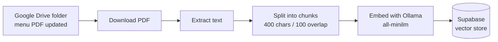
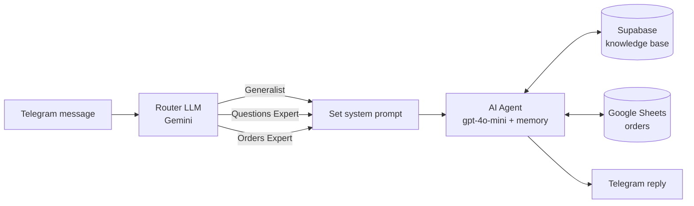

# Nile Sofra: AI Restaurant Assistant

A Telegram assistant for an Egyptian restaurant, built with **n8n**. It answers menu questions from a knowledge base (RAG) and takes, looks up and cancels orders in Google Sheets.

## What it does

- **Answers questions** about the menu and the restaurant (drinks, mains, appetizers, desserts, extras, delivery) using the menu PDF as its knowledge base.
- **Handles orders.** It collects name, phone number, address and items, asks for confirmation, generates a 4-digit order ID and saves the order to Google Sheets.
- **Looks up and cancels orders** by order ID.
- **Greets customers** and keeps the last 12 messages of each chat as context.

## How it works

The project is two n8n workflows.

### 1. Menu ingestion (`workflows/01-menu-ingestion.json`)

When the menu PDF in a Google Drive folder is added or updated, it is turned into searchable chunks.



### 2. Customer support agent (`workflows/02-customer-support-agent.json`)

Every Telegram message is first routed to a role. Each role gets its own system prompt, then one AI Agent answers using the tools.



Agent tools: knowledge base search (top 6 chunks), read order, write order, cancel order, and a code tool that generates the order ID.

## Tech stack

| Part | Tool |
|---|---|
| Automation | n8n |
| Chat channel | Telegram Bot API |
| Router model | Google Gemini |
| Agent model | OpenAI gpt-4o-mini |
| Embeddings | Ollama (`all-minilm`), run locally |
| Vector store | Supabase (pgvector) |
| Orders database | Google Sheets |
| Menu source | PDF in Google Drive |

## Setup

1. **Telegram bot.** Talk to [@BotFather](https://t.me/BotFather), create a bot and keep the token.
2. **Supabase.** Create a project, open the SQL editor and run `docs/supabase-setup.sql`. It creates the `documents` table and the `match_documents` function.
3. **Ollama.** Install it, then run `ollama pull all-minilm`. If n8n runs in Docker, point the Ollama credential at your computer's address instead of `localhost`.
4. **Google Sheet for orders.** Create a sheet with these columns in row 1: `Order ID`, `Item`, `Price`, `Time`, `Name`, `Phone Number`, `Address`, `Status`.
5. **Google Drive folder** for the menu PDF.
6. **Import the workflows.** In n8n choose Workflows, then Import from file, and import both JSON files.
7. **Create credentials in n8n:** Telegram, Google Gemini, OpenAI, Google Sheets (OAuth2), Google Drive (OAuth2), Supabase and Ollama. Credentials stay inside n8n and are not part of the exported files.
8. **Replace the placeholders:**

   | Placeholder | Where | What to put |
   |---|---|---|
   | `YOUR_GOOGLE_DRIVE_FOLDER_ID` | Menu ingestion, Drive trigger | The last part of your folder's URL |
   | `YOUR_GOOGLE_SHEET_ID` | Support agent, the three order tools | The part of the sheet URL between `/d/` and `/edit` |

9. Put the menu PDF in the Drive folder, activate the ingestion workflow, then activate the support agent and message your bot.

## Try it

- `Hi`
- `What drinks do you have?`
- `I'd like to order ...` (the bot asks for name, phone and address, then confirms)
- `Cancel order 1234`

## Design notes

- **Router first.** A small classification step decides the role, so each role runs with a short, focused system prompt.
- **Small chunks with overlap.** Menu entries are short, so 400-character chunks with 100 characters of overlap keep an item together with its price.
- **Telegram-safe replies.** The final node replaces `*` and `_` so the model's Markdown does not break Telegram messages.

## Limitations and next steps

- Order IDs are random 4-digit numbers with no uniqueness check.
- Anyone who knows an order ID can cancel it. Matching the phone number would fix this.
- The order total comes from the model's reading of the menu text. A Code step that calculates it would make totals deterministic.
- Order status only moves between `Preparing` and `Cancelled`.

## Repository structure

```
workflows/
  01-menu-ingestion.json
  02-customer-support-agent.json
docs/
  supabase-setup.sql
```

## Author

Ahmed Abdelazeem Mohamed ([GitHub](https://github.com/Ahmed-Abdelazeem-466))

## License

MIT. See [LICENSE](LICENSE).

---

*README drafted with AI assistance (Claude) and reviewed by the author.*
